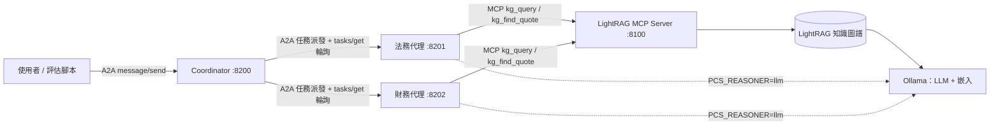

# 跨文件採購合規檢核：A2A 多代理 + MCP + LightRAG

這是一個專題的實作骨架，目標是讓系統在**多份文件之間**找出採購規定的衝突並做出正確判斷。核心案例如下：

| 文件 | 內容 |
|---|---|
| A 採購作業規定 | A-3「採購逾 50 萬需公開招標」；A-5「除特別規定外不得免除」 |
| B 緊急修繕作業要點 | B-1「本要點為 A-5 之特別規定」；B-3「緊急修繕 100 萬以下得免招標」；B-4「報價須在事故後 7 日內」；B-5「須事後報備」 |
| C 報價單 | 60 萬配電盤緊急修繕，事故後 2 日報價 |

正確答案是 **CONDITIONAL（有條件合規）**：可以免公開招標，但必須事後報備。要得出這個答案，系統必須同時串起 A、B、C 三份文件，只看任何一份都會判錯。

## 架構



- **法務代理**：判斷是否符合緊急修繕資格（B-2、B-4），確認 B 是否為 A 的特別規定（A-5 + B-1），並列出附帶義務（B-5）。
- **財務代理**：計算採購金額，用廠商名稱查詢圖譜找出同廠商的其他報價，依 A-4 合併計算，再比對 A-2、A-3 的門檻與 B-3 的豁免上限。
- **Coordinator**：把問題同時派給兩個代理，輪詢它們的狀態，再彙整結論與衝突說明。

## 目錄

```
data/corpus/            測試題庫文件：A、B 為規章；C–I 為報價單；Z 為干擾文件
data/testset/cases.jsonl  6 個測試案例（預期結論、應引用條文、是否含衝突、必要文件）
src/pcs/kg/             mini_graph.py（離線圖譜）、lightrag_backend.py（LightRAG + Ollama）、build.py（建庫與 A–B 串連驗證）
src/pcs/mcp_server/     MCP Server，提供 kg_query / kg_get_document / kg_find_quote / kg_stats 四個工具
src/pcs/mcp_client.py   代理端 MCP 客戶端（HTTP 或 in-memory）
src/pcs/agents/         a2a.py（A2A 協定）、coordinator.py、legal.py、finance.py
src/pcs/reasoning.py    確定性規則推理器：只能使用檢索到的條文
src/pcs/eval/           baseline.py（單一代理 RAG）、run_eval.py（消融實驗與指標計算）
tests/                  14 個測試：圖譜、MCP、A2A 任務生命週期、端到端
```

## 兩種執行設定

| 環境變數 | 離線驗證（預設） | 正式實驗 |
|---|---|---|
| `PCS_KG_BACKEND` | `mini`：內建輕量圖譜，模仿 LightRAG 的 naive/local/global/hybrid 模式 | `lightrag`：lightrag-hku，以 Ollama 抽取實體與關係 |
| `PCS_REASONER` | `rule`：確定性規則推理，結果可重現 | `llm`：本機 Ollama LLM，可量測幻覺率 |

離線設定不需要 GPU 也不需要 Ollama，用來驗證整條「A2A → MCP → 知識圖譜」管線。論文數據請一律使用正式實驗設定。

## 快速開始

```bash
cd procurement-compliance
pip install -r requirements.txt
export PYTHONPATH=src

pytest -q                                   # 14 passed
python -m pcs.kg.build                      # 建庫，並驗證 hybrid 模式可串連 A、B
python -m pcs.demo                          # 單機 Demo（三個代理在同一個行程內，仍走完整 A2A/MCP 協定）
python -m pcs.eval.run_eval                 # 消融實驗，結果輸出到 results/
```

## 依週次對應

1. **第 1–2 週：環境與資料準備**
   - 用 `docker compose up -d ollama` 啟動 Ollama，再執行 `./scripts/pull_models.sh` 下載模型。預設模型為 `qwen2.5:7b-instruct` 與 `bge-m3`。
   - 題庫在 `data/corpus/` 與 `data/testset/cases.jsonl`。
2. **第 3–5 週：LightRAG 與 MCP**
   - 執行 `docker compose run --rm kg-build` 建庫。它會用 hybrid 模式查詢，驗證是否同時取回 A 與 B。
   - 啟動 MCP Server：`docker compose up -d kg-mcp`，服務位址為 `http://localhost:8100/mcp`。
   - 也可以改用 `--transport stdio`，直接接到 Claude Desktop 或 MCP Inspector。
3. **第 6–8 週：A2A 多代理**
   - 啟動代理：`docker compose up -d legal-agent finance-agent coordinator`。
   - 執行 `./scripts/a2a_smoke.sh` 測試。它會讀取 Agent Card、用 `message/send` 建立任務，再用 `tasks/get` 輪詢狀態。
4. **第 9–10 週：消融實驗**
   - 執行 `docker compose run --rm eval`，或在本機執行 `PCS_REASONER=llm PCS_KG_BACKEND=lightrag python -m pcs.eval.run_eval --repeats 3`。

## 評估設計（2×2 消融）

|  | 向量檢索（naive） | 知識圖譜（LightRAG hybrid） |
|---|---|---|
| **單一 LLM**（一次檢索、一次判斷） | `single-naive`（基線） | `single-hybrid` |
| **A2A + MCP 多代理** | `a2a-naive` | `a2a-hybrid`（完整系統） |

所有系統使用相同的 `top_k`（預設 5）。也可以加入 `local`、`global` 模式做比較，例如 `--systems a2a-local,a2a-global`。

**指標**

- **結論正確率**：結論與預期相同的比例。
- **跨文件衝突檢出率**：只計算含衝突的案例。結論必須正確，而且引用條文要涵蓋預期條文，才算檢出。這可以排除「答對但理由錯」的情況，例如沒檢索到 B，卻因為不知道有豁免規定而碰巧判成 VIOLATION。
- **條文召回 / 文件召回**：引用條文涵蓋預期條文的比例，以及檢索證據涵蓋必要文件的比例。
- **幻覺率**：無依據引用數 ÷ 總引用數。「無依據」指引用的條文不存在於語料中，或不在該系統這次檢索到的證據裡。

**離線設定的結果**（`mini` + `rule`，top_k=5，完整檔案見 `results/eval_mini-rule.md`）

| 系統 | 結論正確率 | 跨文件衝突檢出率 | 條文召回 | 文件召回 |
|---|---|---|---|---|
| single-naive（基線） | 0.0% | 0.0% | 0.0% | 44.4% |
| single-hybrid | 66.7% | 25.0% | 77.8% | 100.0% |
| a2a-naive | 100.0% | 100.0% | 100.0% | 100.0% |
| a2a-hybrid | 100.0% | 100.0% | 100.0% | 100.0% |

解讀這組數字前，請注意以下幾點：

- 在只有一次檢索的情況下，圖譜檢索明顯優於向量檢索。向量檢索的前 5 名全是相似的報價單，抓不到任何條文。
- 改成多代理後，每個代理會用自己的子查詢檢索，這個「任務拆解」本身就補足了大部分差距。所以在這個只有 10 份文件的小語料上，`a2a-naive` 也達到滿分，**無法分辨圖譜檢索在多代理架構中的貢獻**。
- 要讓 `a2a-naive` 與 `a2a-hybrid` 拉開差距，建議擴充題庫：加入更多相似的干擾規章與報價單、只提供部分報價單號的分批案例，以及用詞不同的條文（例如「急迫」與「緊急」）。
- rule 推理器的幻覺率恆為 0。幻覺率要在 `PCS_REASONER=llm` 下量測，並設定 `--repeats` 重複執行以估計變異。

## 目前狀態與限制

- **已驗證**：離線設定下的完整管線，包括 14 個測試全部通過，以及多行程部署的端到端流程。多行程部署指 MCP Server 走 Streamable HTTP、三個代理各自是獨立的 HTTP 服務，再用 curl 走 A2A 協定。
- **尚未驗證**：以下兩條路徑已經寫好程式，但這個開發環境沒有 Ollama，所以還沒實際跑過。第一次在本機執行時請先確認：
  - LightRAG 後端：`lightrag_backend.py`，依 lightrag-hku 1.x 的 API 撰寫。
  - LLM 推理器：`PCS_REASONER=llm`。
- `pcs.agents.a2a` 是 A2A 協定的精簡子集，包含 Agent Card、`message/send`、`tasks/get`、`tasks/cancel`。若論文需要符合官方規格，可以改用 `a2a-sdk`。
- 程式依賴 `mcp>=2`。v2 的 FastMCP 已改名為 `MCPServer`。
